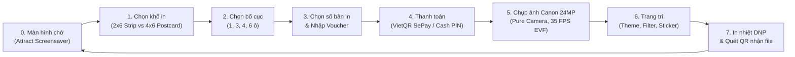
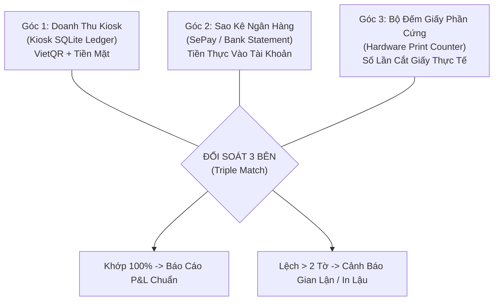

# FOTOLISM 3.0 — TÀI LIỆU ĐẶC TẢ NGHIỆP VỤ HỆ THỐNG
## (BUSINESS REQUIREMENTS SPECIFICATION - BRS)
> **Mã tài liệu:** FOTOLISM-BRS-3.0  
> **Phiên bản:** 3.0.0 (Master Reference Document)  
> **File Word tương ứng:** `F:\JoyBooth\FOTOLISM_NGHIEP_VU_HE_THONG.docx`  
> **Hệ sinh thái:** Fotolism Photobooth & Cloud CMS Suite  
> **Thời điểm ban hành:** Tháng 10/2026  
> **Trạng thái:** Tài liệu gốc tham chiếu trong toàn bộ dự án  

---

## 🏛️ CHƯƠNG 1: TỔNG QUAN HỆ THỐNG & NGUYÊN TẮC CỐT LÕI

### 1.1 Bối cảnh & Tầm nhìn kinh doanh
Fotolism là giải pháp photobooth chụp ảnh thế hệ mới, được thiết kế chuyên biệt cho thị trường trung tâm thương mại, khu vui chơi, quán cà phê và sự kiện tại Việt Nam. Không dừng lại ở một ứng dụng chụp ảnh đơn lẻ, Fotolism được xây dựng thành một hệ sinh thái đồng bộ gồm: **Trạm Kiosk cảm ứng tự phục vụ (Self-service Kiosk)** và **Trung tâm Quản trị Đám mây (Cloud CMS)**.

**Mục tiêu kinh doanh cốt lõi:**
1. **Trải nghiệm khách hàng mượt mà, thời thượng:** Khách hàng chỉ mất từ 90 đến 120 giây từ lúc chọn khung đến khi cầm trên tay dải ảnh in sắc nét và video hậu trường.
2. **Vận hành tự động hoá 100%:** Thanh toán chuyển khoản tự động quét QR 24/7 nhận tiền trong 1 giây qua ngân hàng MBBank/SePay, không phụ thuộc nhân viên thu tiền.
3. **Chống thất thoát tài chính tuyệt đối:** Áp dụng cơ chế kiểm kê đối soát 3 bên giữa Tiền ghi nhận Kiosk, Tiền thực tế vào tài khoản ngân hàng và Số lượng vật tư giấy in tiêu hao.
4. **Khả năng mở rộng không giới hạn:** Thiết kế sẵn sàng cho việc mở rộng từ 2 máy ban đầu lên chuỗi 20 đến 100 máy Kiosk đa chi nhánh mà không tốn chi phí hạ tầng đắt đỏ.

### 1.2 5 Nguyên tắc kiến trúc bất biến (Architectural Tenets)
1. **Offline-First (Ngoại tuyến là trên hết):** Mất Internet tuyệt đối không được phép làm gián đoạn việc chụp ảnh, ghép khung hay in ảnh của khách. Mọi giao dịch và dữ liệu phải được lưu trữ bền vững tại Local SQLite trước khi đồng bộ lên Cloud.
2. **Pure Camera (Chất lượng quang học thuần khiết):** Sử dụng cảm biến 24MP từ thân máy Canon EOS R100/R50 chuyên nghiệp. Không lật gương (No Mirror), không áp dụng các bộ lọc làm biến dạng màu sắc quang học mặc định, tạo ra độ chi tiết và sắc thái vượt trội so với các booth dùng webcam.
3. **Idempotency & Zero-Leakage (Chống trùng lặp & Rò rỉ):** Mỗi giao dịch ngân hàng (Mã tham chiếu SePay) và mỗi lệnh chụp/in đều có định danh duy nhất (Idempotent Key). Ngăn chặn dứt điểm tình trạng quét mã nhận 2 lần tiền hoặc bấm nút làm máy in xả 2 lần giấy.
4. **Lean Cloud Cost (Chi phí vận hành Cloud = 0đ):** Tận dụng tối đa Free-tier của Supabase (PostgreSQL 500MB), Next.js Vercel, Cloudflare R2 (Miễn phí băng thông tải ảnh 0đ Egress) và OpenSSH Tunnel.
5. **Separation of Concerns (Tách bạch trách nhiệm):** Kiosk chỉ chịu trách nhiệm tương tác phần cứng và trải nghiệm khách. Cloud CMS chịu trách nhiệm chốt giá, voucher, phân phối khung ảnh và báo cáo doanh thu.

---

## 👥 CHƯƠNG 2: CÁC TÁC NHÂN HỆ THỐNG & PHÂN QUYỀN (ACTORS & ROLES)

| Tác nhân (Actor) | Vị trí / Thiết bị | Trách nhiệm & Quyền hạn nghiệp vụ |
| :--- | :--- | :--- |
| **Khách hàng (Customer)** | Màn hình cảm ứng Kiosk chính | Tương tác chạm, chọn gói, quét QR thanh toán, tạo dáng chụp ảnh, trang trí sticker và nhận ảnh in kèm mã QR tải file về điện thoại. |
| **Nhân viên quầy (Booth Staff)** | Quầy phụ trợ tại điểm đặt booth | Hỗ trợ khách hàng lớn tuổi/trẻ em, mở khoá phiên khẩn cấp bằng mã PIN (Staff PIN: `888888`) khi có sự cố mạng, thay cuộn giấy in khi sắp hết. |
| **Quản lý chi nhánh (Store Manager)** | Dashboard Web (Mobile/Laptop) | Theo dõi doanh thu ca làm việc, đối soát số tiền mặt nhân viên nộp lại, duyệt yêu cầu in lại khi kẹt giấy, kiểm tra vật tư cuộn giấy. |
| **Chủ chuỗi (Chain Owner)** | Dashboard Web di động | Xem báo cáo P&L lợi nhuận ròng thời gian thực, quản lý bảng giá toàn hệ thống, tạo mã voucher khuyến mãi, quản lý phân quyền và rút tiền. |
| **Kỹ thuật viên (Technician)** | Kiosk Admin / Cổng bảo trì | Hiệu chỉnh góc máy ảnh Canon, cân màu máy in DNP/HiTi, cấu hình cổng COM/USB, kiểm tra log camera daemon, cập nhật phiên bản ứng dụng. |

---

## 🚀 CHƯƠNG 3: QUY TRÌNH NGHIỆP VỤ TRẢI NGHIỆM KHÁCH HÀNG (CUSTOMER JOURNEY)

### Chi tiết 8 bước nghiệp vụ:
- **Bước 0: Màn hình chờ & Thu hút (Idle Attract Screen):** Chạy video screensaver hoặc slideshow các dải ảnh mẫu bắt mắt. Chạm vào màn hình để bắt đầu. Khởi tạo mã phiên `Session ID` (VD: `FTL_20261030_XXXX`).
- **Bước 1: Chọn định dạng khung & Khổ in (Frame Size):**
  - **Dải Strip đôi (2x6 inch):** In trên khổ 4x6 và dao cắt tự động chia đôi thành 2 dải (Giá gốc: `50.000 VNĐ`, tối thiểu 2 dải).
  - **Postcard (4x6 inch):** 1 tấm ảnh bưu thiếp khổ lớn nguyên bản (Giá gốc: `70.000 VNĐ`, tối thiểu 1 tấm).
- **Bước 2: Chọn bố cục khung hình (Layout Selection):**
  - Khổ 2x6: Bố cục 3 ô dọc (Classic 3-cut), 4 ô dọc (Standard 4-cut), hoặc 1 ô lớn nghệ thuật.
  - Khổ 4x6: Bố cục 4 ô vuông (Grid 2x2), 6 ô (Grid 2x3), hoặc 8 ô mini.
- **Bước 3: Chọn số lượng bản in & Nhập mã ưu đãi (Quantity & Coupon):**
  - Khách có thể tăng số bản in theo bước nhảy: +2 dải đối với 2x6 (+25.000đ), +1 tấm đối với 4x6 (+35.000đ).
  - Nhập mã Coupon (VD: `FOTOLISM10` giảm 10% hoặc mã giảm tiền mặt trực tiếp). Hệ thống tự động chốt số tiền cần trả.
- **Bước 4: Thanh toán tự động VietQR SePay:**
  - Hiển thị mã QR động chuẩn NAPAS mang số tài khoản MBBank `03609032002` (`NGUYEN HOANG`).
  - Nhúng sẵn số tiền chính xác và nội dung chuyển khoản là mã đơn hàng `FTL######` qua tham số `&des=` và `&addInfo=`.
  - Bộ đếm thời gian 120 giây. Khi tiền vào tài khoản, Webhook SePay bắt biến động và mở khóa màn hình chụp ảnh trong vòng 1.2 giây.
  - Hỗ trợ Smart Match tự động cứu hộ nếu khách dùng ví điện tử bị ghi đè nội dung.
- **Bước 5: Trải nghiệm chụp ảnh Studio Pure Camera:**
  - Kéo luồng Live View EVF 35 FPS trực tiếp từ Canon EOS R100 qua USB.
  - Đếm ngược 3s - 5s - 10s cho mỗi dáng chụp.
  - Màn trập cơ học Canon xả đúng 1 nhịp dứt khoát không có độ trễ lấy nét (`Completely_NonAF`).
  - Không lật gương (No Mirror), giữ nguyên góc nhìn thực tế quang học studio.
  - File ảnh 24MP full EXIF được truyền thẳng về máy Kiosk và ghi vào ổ đĩa `F:\Fotolism_image`.
- **Bước 6: Trang trí dải ảnh & Bộ lọc màu:**
  - Chọn Theme Frame (Khung viền màu pastel, phong cách Y2K, khung sinh nhật, lễ hội).
  - Bộ lọc màu điện ảnh (Vintage, B&W tương phản cao, Film Warm, Korean Natural).
  - Thêm Sticker và ký tên điện tử lên dải ảnh.
- **Bước 7: Xuất file in nhiệt & Quét QR nhận file:**
  - Bộ xử lý đồ hoạ Canvas kết xuất dải ảnh hoàn chỉnh ở độ phân giải 300 DPI chuẩn in ấn.
  - Gửi lệnh in trực tiếp đến máy in nhiệt DNP RX1HS qua Windows Spooler. Thời gian in: ~12 giây.
  - Màn hình hiển thị mã QR Delivery tức thì để khách hàng quét camera điện thoại tải trọn bộ: Dải ảnh hoàn thiện (JPG), Từng ảnh đơn 24MP và Video Timelapse hậu trường (MP4) về máy.

---

## 💳 CHƯƠNG 4: NGHIỆP VỤ THANH TOÁN TỰ ĐỘNG VIETQR SEPAY & TIỀN MẶT

### 4.1 Quy tắc nghiệp vụ xử lý dòng tiền
1. **Mã VietQR động chuẩn EMVCo:** Chứa đầy đủ thông tin tài khoản MBBank, số tiền và mã đơn hàng.
2. **Tiếp nhận Webhook qua đường truyền riêng:** Tiếp nhận dữ liệu từ SePay và phản hồi HTTP 200 trong vòng < 50ms, ghi nhận giao dịch vào Sổ cái (Ledger).
3. **Cơ chế Khớp lệnh Cứu hộ Thông minh (Smart Match):** Nếu khách hàng chuyển khoản qua ví điện tử (ViettelMoney/ZaloPay) bị mất mã đơn hàng trong nội dung, hệ thống sẽ tự động quét các giao dịch tiền vào chưa gán mã đơn trong vòng 60 phút gần nhất. Nếu số tiền trùng khớp 100%, hệ thống tự động ghép giao dịch và mở máy chụp ảnh.
4. **Cơ chế Bảo vệ Doanh thu:** Nếu khách chuyển thiếu tiền (VD: Đơn 70.000đ nhưng chỉ chuyển 50.000đ), hệ thống từ chối ghép đơn để bảo vệ dòng tiền. Giao dịch được gắn nhãn `UNMATCHED` để quản lý kiểm tra.
5. **Xác nhận Tiền mặt qua Staff PIN:** Khi khách trả tiền mặt hoặc mạng ngân hàng bảo trì, nhân viên quầy nhập Staff PIN (`888888`) để mở máy. Giao dịch được ghi nhận là `cash` kèm mã nhân viên để đối soát cuối ca.

---

## 📷 CHƯƠNG 5: NGHIỆP VỤ ĐIỀU KHIỂN PHẦN CỨNG (CANON EDSDK & MÁY IN)

### 5.1 Tiến trình Canon EDSDK Persistent Daemon (`fotolism_canon_daemon.exe`)
- Chạy ngầm độc lập dạng 64-bit C# .NET, lắng nghe tại cổng nội bộ `http://127.0.0.1:8899/`.
- Kéo luồng Live View (EVF) 35 FPS với độ trễ < 30ms trực tiếp từ cảm biến máy ảnh.
- Vòng lặp Keep-Alive (chống ngủ) mỗi 15 giây: Gửi lệnh `kEdsCameraCommand_ExtendShutDownTimer` giúp máy ảnh không bao giờ bị tắt nguồn tự động.
- Chụp không trễ (Zero AF Shutter): Gửi lệnh `Completely_NonAF`, rèm trập xả đúng 1 nhịp tách dứt khoát, loại bỏ hoàn toàn hiện tượng lấy nét lại làm giật hình.

### 5.2 Quản lý máy in nhiệt dye-sub (DNP RX1HS / HiTi P525L)
- **Chế độ 2-inch cut:** Tự động cắt đôi khổ 4x6 thành 2 dải 2x6 bằng dao cắt cơ học phần cứng.
- **Định mức cuộn giấy:** 1 cuộn giấy DNP in được 400 tấm 4x6 (800 dải 2x6). Kiosk đếm lùi số tờ sau mỗi lệnh in và gửi cảnh báo về Cloud CMS khi cuộn giấy còn dưới 20 tấm.
- **Chống in lậu:** Mọi lệnh in đều phải có Session ID và hoá đơn thanh toán hợp lệ.

---

## 📊 CHƯƠNG 6: NGHIỆP VỤ KẾ TOÁN & ĐỐI SOÁT DOANH THU 3 BÊN (TRIPLE RECONCILIATION)

### Công thức đối soát bắt buộc:
$$\text{Tổng số bản in thực tế từ máy in} = \text{Số bản in theo đơn hàng đã trả tiền} + \text{Số bản in lỗi được in lại (có ảnh bằng chứng)}$$
Bất kỳ sai số nào vượt quá **2 bản in/ngày** sẽ được hệ thống gắn cờ `DISCREPANCY_ALERT` và gửi thông báo tức thì lên ứng dụng di động của Chủ chuỗi.

---

## 💾 CHƯƠNG 7 (TASK 2): PHÂN TÍCH DỮ LIỆU & KIẾN TRÚC DATABASE TỐI ƯU

### 7.1 Ma trận phân bổ cơ sở dữ liệu tối ưu nhất (Database Storage Matrix)

| Nhóm dữ liệu | Thành phần dữ liệu cụ thể | Tần suất & Đặc tính | Công nghệ lưu trữ tối ưu | Lý do lựa chọn & Kiến trúc kỹ thuật |
| :--- | :--- | :--- | :--- | :--- |
| **1. Điều khiển phần cứng** | Frame buffer Live View, trạng thái máy ảnh (CONNECTED, BUSY), nhiệt độ cảm biến, lệnh màn trập. | 35-40 FPS, liên tục | **In-Memory RAM (C# Daemon & Zustand)** | Không ghi đĩa; giữ trong RAM để đảm bảo độ trễ = 0ms, không làm mòn ổ SSD. |
| **2. Tệp media cục bộ** | Ảnh gốc 24MP (JPG), file dải in 300 DPI, video hậu trường MP4/WebM. | Dung lượng lớn (20-80MB/phiên) | **Local NVMe/SSD Filesystem (`F:\Fotolism_image`)** | Lưu trực tiếp vào ổ đĩa tốc độ cao với cấu trúc phân cấp thư mục theo ngày/phiên. |
| **3. Phiên chụp & Hàng đợi Kiosk** | Session ID, slot photos, trạng thái phiên (CAPTURING, COMPLETED), sync queue. | Giao dịch ACID cục bộ | **Local SQLite (WAL Mode)** | Bền vững khi mất điện đột ngột; hỗ trợ đọc ghi đồng thời không khoá giao diện. |
| **4. Giao dịch & Sổ cái tài chính** | Order code, số tiền, ngân hàng, bank ref SePay, nội dung chuyển khoản, kênh thanh toán. | Yêu cầu toàn vẹn 100% | **Cloud PostgreSQL (Supabase) + Local SQLite** | Ghi kép: SQLite đảm bảo offline, PostgreSQL trên Cloud hỗ trợ đối soát tập trung và báo cáo. |
| **5. Vật tư & Bộ đếm máy in** | Số cuộn giấy nạp, số lượt cắt giấy cơ học, số bản in đã xuất, log in lại. | Dữ liệu kiểm kê, Append-Only | **Local SQLite + Cloud PostgreSQL (Audit Table)** | Chỉ ghi thêm, không cho phép sửa/xoá để chống nhân viên can thiệp gian lận. |
| **6. Cấu hình kinh doanh & Khung** | Bảng giá gói, danh mục Voucher, khung viền PNG, bố cục Layout, Sticker. | Đọc thường xuyên, cập nhật định kỳ | **Cloud PostgreSQL (Master) -> Local JSON Cache** | Cloud CMS là nguồn chân lý duy nhất (Single Source of Truth); Kiosk lưu cache để khởi động ngay. |
| **7. Giám sát thiết bị (Telemetry)** | Heartbeat mỗi 60s, CPU/RAM Kiosk, dung lượng ổ cứng, nhiệt độ máy in, số lượng giấy còn lại. | Chuỗi thời gian (Time-series) | **Cloud PostgreSQL (TimescaleDB / JSONB Table)** | Cho phép vẽ biểu đồ giám sát thời gian thực và tự động kích hoạt cảnh báo sự cố. |
| **8. Phân phối media khách hàng** | Mã QR tra cứu, link tải ảnh công khai, file JPG 300 DPI, video MP4. | Băng thông tải về cực lớn từ mobile | **Cloudflare R2 Object Storage + Global CDN** | **Miễn phí 100% chi phí băng thông tải về (Zero Egress Fee)**, tiết kiệm hàng triệu đồng/tháng. |

---

## 🎯 BẢNG THAM CHIẾU QUYẾT ĐỊNH THIẾT KẾ (ADR)

- **ADR-01 (Cổng thanh toán VietQR SePay):** Tiếp nhận biến động số dư tức thì 24/7 từ MBBank, tự động sinh mã QR động chứa `&des=` và `&addInfo=`.
- **ADR-02 (Canon EDSDK Daemon 64-bit):** Khắc phục triệt để lỗi màn trập nháy 2 lần, nâng tốc độ Live View lên 35 FPS, chống ngủ máy ảnh và không bị nghẽn giao diện.
- **ADR-03 (Cloudflare R2 cho QR Delivery):** Loại bỏ 100% chi phí băng thông tải ảnh của khách hàng so với AWS S3 truyền thống.
- **ADR-04 (Mô hình lưu trữ kép Offline-First):** Kiosk vận hành độc lập hoàn toàn bằng Local SQLite và SSD `F:\Fotolism_image`; tự động đồng bộ lên Supabase Cloud khi có mạng.

